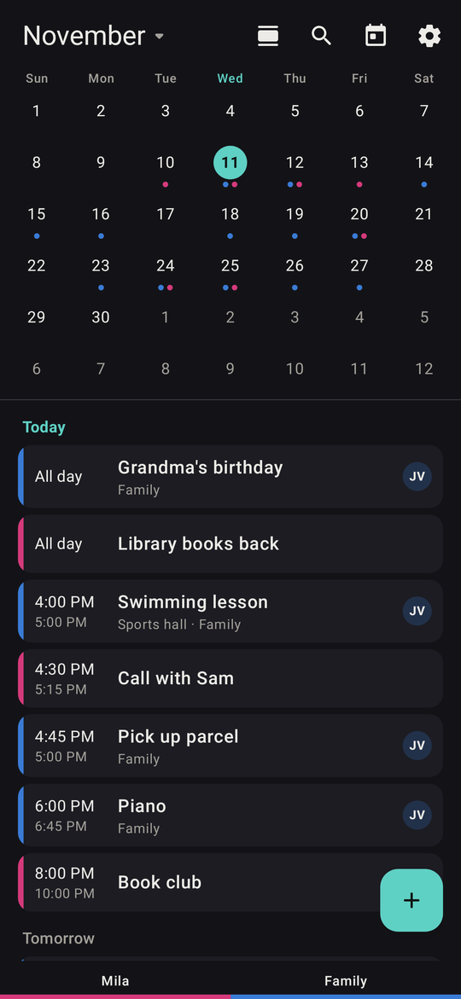
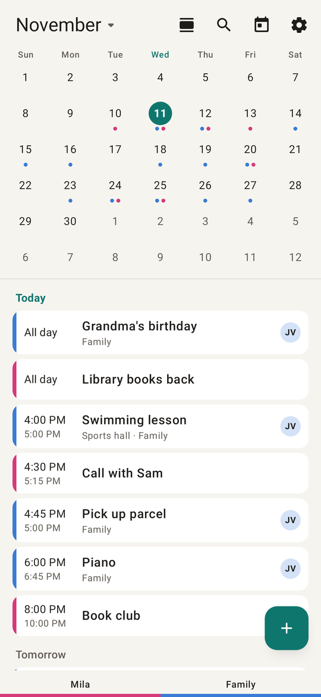
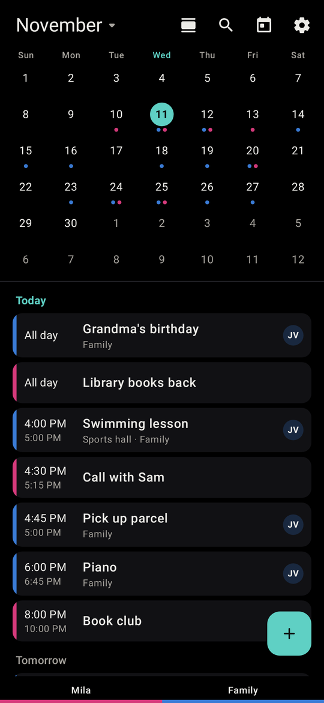
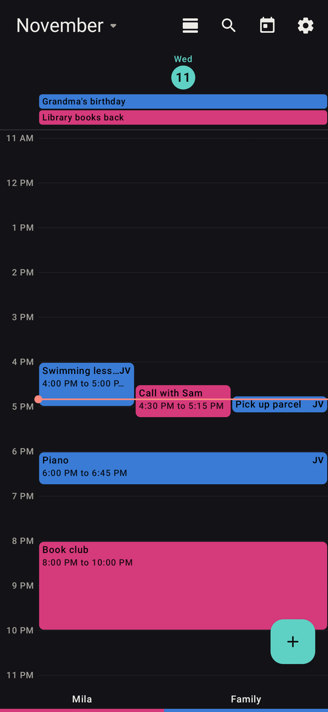
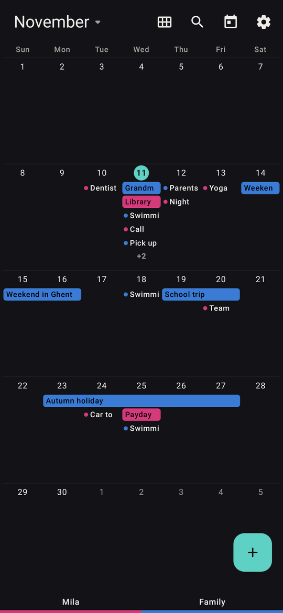
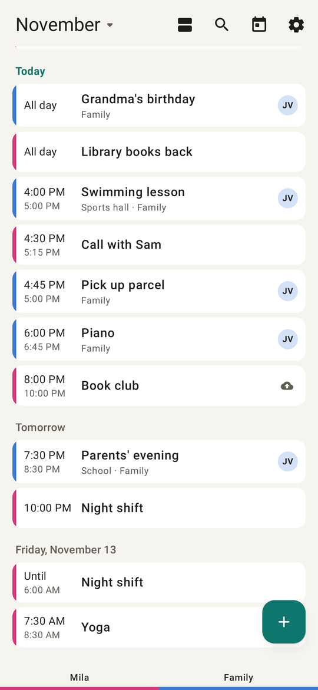
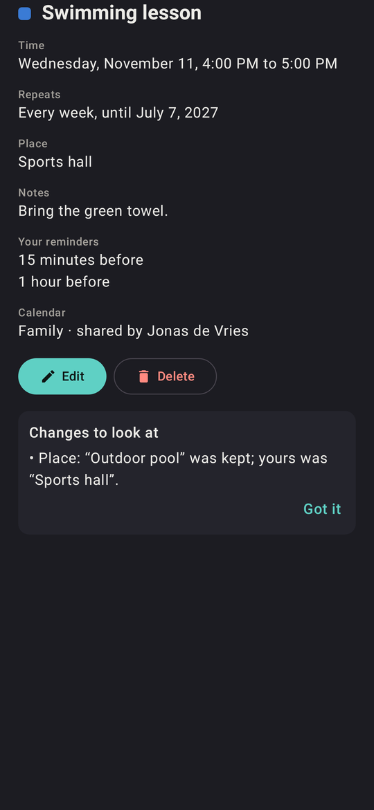
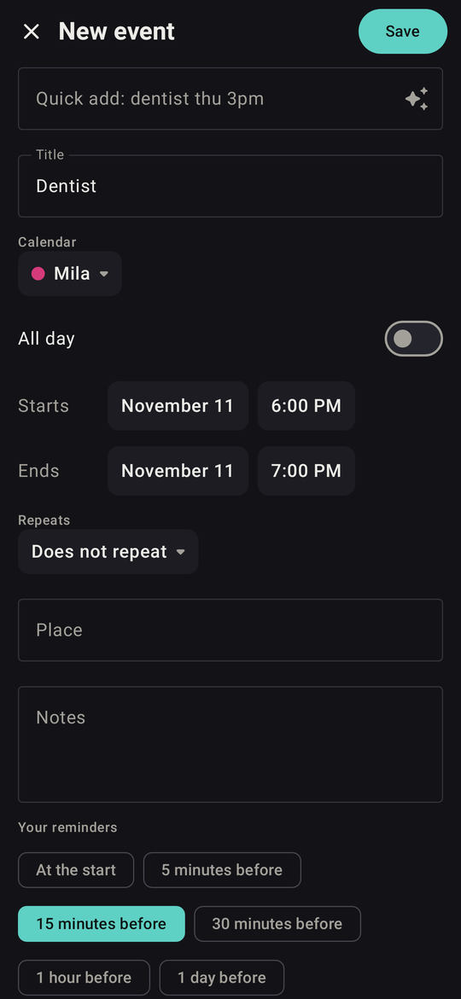
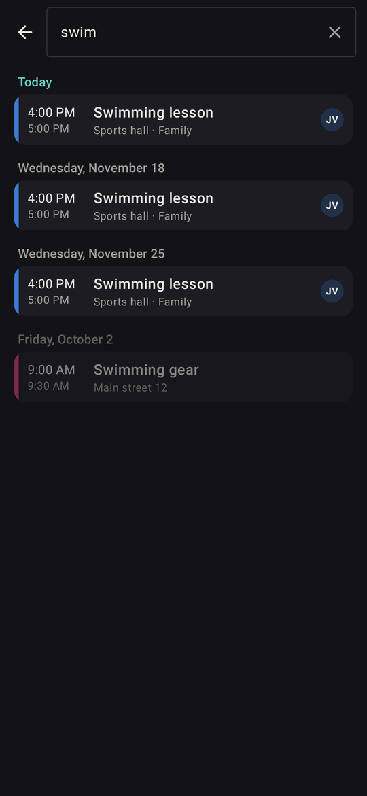
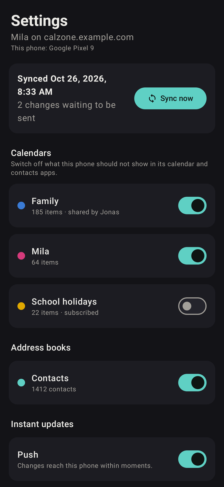

# CalZone for Android

The phone app for [CalZone](https://github.com/xblackbytesx/calzone-server),
a self-hosted calendar and contacts system for a household. Sign in by
scanning a QR code from CalZone's website. Your calendars and contacts live
on the phone, and sync with your own server.

<table>
  <tr>
    <td width="33%"></td>
    <td width="33%"></td>
    <td width="33%"></td>
  </tr>
  <tr>
    <td align="center">Dark (the default)</td>
    <td align="center">Light</td>
    <td align="center">Black, for OLED screens</td>
  </tr>
</table>

Screenshots show a made-up household.

## Features

- **Its own calendar**: month and days (a small month over the list of its
  days, the default), agenda, day, week and month. Swipe to page, and a
  legend along the bottom shows each calendar's color. Events from
  someone else's calendar carry their initials.
- **Editing**, with quick add ("dentist thu 3pm", also in Dutch). Repeating
  events can be changed for one, this and following, or all occurrences.
  Every change can be undone for 10 seconds.
- **Reminders that ring on time**: CalZone sets its own exact alarms, and
  they still ring after a reboot, before the phone is unlocked, with Snooze
  and Open on each notification. On a shared calendar, your reminders are
  yours alone.
- **Search** across titles, places and notes, past and future.
- **Two home screen widgets**: the next two weeks, and a month with a
  colored dot per calendar on each day.
- **Works with the rest of the phone, replacing DAVx5**: your calendars
  show in the phone's other calendar apps, and your address books in its
  Contacts app, dialer and messengers. Changes made there come back to
  CalZone, merged field by field, keeping custom labels, groups and
  photos. "Add to calendar" from other apps opens CalZone's editor.
- **Offline first**: edits made without a connection are sent later and
  merged field by field. When two people change the same thing, you're
  told in plain words what was kept.
- **Instant updates** through UnifiedPush (for example ntfy), if you want
  them. Otherwise it syncs after your own edits, on pull to refresh, and
  when Android schedules it.
- **Private**: no Google Play Services, no tracking, no cloud backup. It
  talks only to your own server and your push distributor.
- **Your own colors and names** per calendar, a default reminder for new
  events, and a choice of which calendars and address books this phone
  shows.
- English and Dutch, following the phone. Dark, Light, Black or System
  theme.

## Screenshots

<table>
  <tr>
    <td width="33%"></td>
    <td width="33%"></td>
    <td width="33%"></td>
  </tr>
  <tr>
    <td align="center">Day</td>
    <td align="center">Month</td>
    <td align="center">Agenda, Light theme</td>
  </tr>
  <tr>
    <td></td>
    <td></td>
    <td></td>
  </tr>
  <tr>
    <td align="center">An event, with a conflict explained</td>
    <td align="center">Adding an event</td>
    <td align="center">Search</td>
  </tr>
</table>

  
   Settings: sync status, what this phone shows, instant updates

## Install

1. Run [CalZone's server](https://github.com/xblackbytesx/calzone-server)
   (0.7.0 or newer).
2. Install the APK from this repo's
   [releases](https://github.com/xblackbytesx/calzone/releases/latest),
   ideally through [Obtainium](https://github.com/ImranR98/Obtainium) so
   updates arrive by themselves. Add this repo's address in Obtainium.
3. On CalZone's website, go to Settings, Devices and add this phone. Then
   scan the QR code in the app, or with the phone's camera.

Moving a phone over from DAVx5:
[docs/switch-over.md](docs/switch-over.md).

## Build

Needs Docker, and the server repo checked out next to this one
(`../calzone-server`): the app runs the same Rust core as the server,
built from there.

| Command | What |
|---|---|
| `make build` | debug APK in `build-output/` |
| `make test` | JVM tests, with the real Rust core |
| `make lint` | Android lint, the CI gate |
| `make screenshots` | every screen in `build-output/screenshots/` |
| `make release` | release APK, signed when a keystore is set up |
| `make install` | install the debug APK over adb |

The README images are a selection of `make screenshots`, scaled to 540
pixels wide, in `docs/screenshots/`. `AGENTS.md` describes how the app is
put together and why. Kotlin, Jetpack Compose with Material 3, Hilt and
Glance; the core is Rust, reached through UniFFI.

## License

GPL-3.0-or-later. See [LICENSE](LICENSE). The contact field list in
`app/src/main/res/xml/contacts.xml` comes from
[DAVx5](https://github.com/bitfireAT/davx5-ose) (GPL-3.0).
